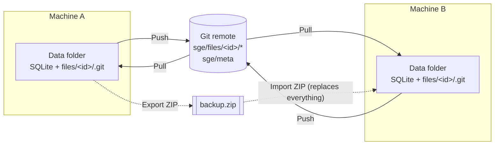

# Storage and sync

SincroGitExclude keeps your data in two layers:

1. **Local storage**, always on. A data folder with a SQLite database and one git repository per managed file. This is how the app has always worked, and it is still the source of truth.
2. **Remote sync**, optional. A single git repository (GitHub, GitLab, a bare repository on a NAS...) that every machine pushes to and pulls from. It sits on top of local storage; it does not replace it.

A third mechanism, **Export/Import as ZIP**, takes a full copy of the local storage.

They are not alternatives: remote sync needs local storage, and the ZIP export works whether sync is on or off.



## Local storage

### The data folder

By default it is the app's user data folder; **Settings → Application Data** can move it anywhere.

```
<data folder>/
  sincrogitexclude.db          files, deployments, tags, snapshots, repositories
  files/
    <fileId>/                  one git repository per managed file
      content                  single file: always stored under this name
      config/app.json ...      bundle: the folder tree as it was imported
      .git/
        refs/heads/master      base branch
        refs/heads/deploy-1a2b3c4d   one branch per deployment
        refs/tags/deploy-1a2b3c4d/v1 tags are prefixed with their branch
        sge-index/<deploymentId>     change detection cache for bundles
        refs/remotes/sge/...         only with remote sync: other machines' branches
  temp/
```

Every deployment is a branch of its file's repository: a commit on a deployment is a commit on its branch. Bundles are compared against the deployed folder through a separate index per deployment, so checking for changes never copies files around.

### Per-machine settings

These live in the app's **default** user data folder even when the data folder has been moved, so the app can start and be reached even if the data folder is missing or unreachable:

| File | What |
|---|---|
| `data-path.json` | Where the data folder is, when it is not the default |
| `preferences.json` | Auto-exclude, snapshots, verbose logs |
| `server.json` | Web access: port, network access, token |
| `mcp.json` | MCP access: port, network access, read only, token |
| `sync.json` | Remote URL, this machine's id and name, last push and pull |
| `sync-meta.git/` | Local copy of the shared sync metadata |

None of them travels in a ZIP export or through remote sync.

## Remote sync

Configured in **Settings → Remote sync** with a git URL. Authentication uses this computer's git setup (SSH keys or a credential helper); the app stores no passwords or tokens.

### Layout of the remote

The remote is a plain git repository; every name starts with `sge/` so it does not mix with anything else:

| Ref | Content |
|---|---|
| `refs/heads/sge/files/<fileId>/<branch>` | Every branch of every managed file: `master`, `deploy-…` |
| `refs/tags/sge/files/<fileId>/<tag>` | Their tags |
| `refs/heads/sge/meta` | One commit per change of `meta.json` |

`meta.json` holds:

- `files`: name, alias, type, icon setting, ignore patterns, tags (name and color), and the time of the last metadata change.
- `tombstones`: files deleted on some machine, with the deletion time.
- `machines`: one entry per machine (id, name, last update) listing its deployments: branch, repository path, relative path, description, active.

### Push

1. For each managed file, its branches and tags are pushed under `sge/files/<fileId>/`. Files whose refs already match the remote are skipped without a network round trip.
2. A push is never forced. If another machine has pushed history this one has not seen, that branch is rejected and listed as a conflict.
3. The metadata is merged and pushed: for each file the newest version wins; deletions win over older edits; this machine replaces only its own entry under `machines`. If someone else pushed metadata in between, the merge is retried.

### Pull

1. Files that exist only in the remote are created locally, with their whole history, metadata and tags.
2. For existing files, the other machines' branches are fetched into `refs/remotes/sge/` and shared branches such as `master` are fast-forwarded. **Branches of this machine's deployments are never moved**; if the remote is ahead or has diverged, the pull report says so.
3. Names, aliases, icon setting, ignore patterns and tags are updated when the remote copy is newer.
4. Files deleted on another machine are **not** deleted here: they are listed in the report so you can delete them yourself.

Deployments are not recreated, because their paths only make sense on the machine that made them. After a pull, the **New Deployment** dialog lists them under **Other machines** as a source, with their commits.

## What travels where

| Data | Local storage | ZIP export | Remote sync |
|---|:-:|:-:|:-:|
| File contents, every version, every branch and tag | ✓ | ✓ | ✓ |
| Name, alias, icon setting, ignore patterns | ✓ | ✓ | ✓ |
| File tags | ✓ | ✓ | ✓ (by name) |
| Deployments | ✓ | ✓ (with the original machine's paths) | As sources for new deployments |
| Deployment descriptions | ✓ | ✓ | ✓ (shown with the source) |
| Deployment and repository tags | ✓ | ✓ | ✗ |
| Automatic snapshots | ✓ | ✓ | ✗ |
| Repositories added by hand | ✓ | ✓ | ✗ |
| Deleted files | | | As deletion records |
| Per-machine settings | ✓ | ✗ | ✗ |

## Using them together

### Local only (the default)

Nothing changes from previous versions. Use **Export** for backups.

### Local plus remote sync (recommended for several machines)

Each machine keeps its own **local** data folder and they exchange through the remote. The remote doubles as an off-site backup of every version.

The remote can live anywhere git reaches, including the NAS you may already use. A bare repository on a mounted share works with a plain path, spaces included:

```bash
git init --bare "/Volumes/NAS/sge-data.git"      # once, from any machine
# Remote URL: /Volumes/NAS/sge-data.git   (macOS)
#             //192.168.0.22/share/sge-data.git   (Windows)
#             ssh://user@nas/volume1/git/sge-data.git   (over SSH)
```

### A data folder shared on a network drive

Pointing several machines at the same data folder also works, and remote sync can be added on top, but there are trade-offs:

- SQLite on a network share is fragile: locks and the `-wal`/`-shm` files can fail with "disk I/O error" or `EBUSY`. **Never have two machines open the app on the same folder at the same time.**
- Remote sync between machines that share a folder adds nothing, since they already see the same data. It still works as an off-site backup, from any one of them.

To switch from a shared folder to remote sync:

1. On the machine that has the data: **Settings → Remote sync**, set the URL, **Push**.
2. On each other machine: **Settings → Application Data → Change location**, pick a local folder and **Start fresh**. After the restart, set the same URL and **Pull**.
3. Recreate each machine's deployments from **New Deployment**, choosing the matching deployment under **Other machines** as the source so you keep its history.
4. Only then, on the first machine, delete the deployments that belong to the other machines, **without** deleting their files from disk. They came from the shared database, point to paths that do not exist there, and now live in each machine's own data folder. Doing this before step 3 would remove them from the sources the other machines can pick.

### ZIP export and import

The ZIP is a complete copy of the data folder, including snapshots, at one point in time. **Import replaces everything** in the current data folder. Use it to restore a machine or as a dated backup.

To set up a new machine with remote sync on, prefer **Pull**: an imported ZIP brings the original machine's deployments into the new one, and its next push would announce them as its own.

## Reading the remote without the app

The remote is ordinary git. If the app is not available, plain git is enough to get anything back:

```bash
URL=git@github.com:you/sge-data.git

git ls-remote "$URL"                     # every file, branch and tag

git init recovery && cd recovery
git fetch "$URL" 'refs/heads/sge/meta:refs/remotes/sge/meta'
git show 'sge/meta:meta.json'            # names and aliases, to find the fileId

FILE=<fileId>
git fetch "$URL" "refs/heads/sge/files/$FILE/*:refs/remotes/f/*"
git branch -r                            # master, deploy-...
git show 'f/deploy-1a2b3c4d:config/app.json'      # one file (bundle)
git show 'f/deploy-1a2b3c4d:content' > .env       # single files are stored as "content"
mkdir -p ../restored && git archive 'f/deploy-1a2b3c4d' | tar -x -C ../restored   # a whole bundle
```

Quote `ref:path` arguments: in zsh, `$VAR:a` is a modifier and swallows part of the path.

## Limits

- **Diverged branches are not merged by the app.** A conflict appears when two machines commit on the same branch, typically `master` after adding or removing files of a bundle on both. Resolve it in the internal repository (`files/<fileId>` in the data folder) by merging `refs/remotes/sge/<branch>` into the local branch, then push again.
- **Metadata conflicts are decided by time.** The newest change wins, so clocks that are far apart can make an older edit win.
- **Deleting a file keeps its history in the remote.** It disappears from the metadata, but its branches stay so it can be recovered. To erase it for good, delete the refs by hand: `git push "$URL" --delete $(git ls-remote "$URL" "refs/*/sge/files/<fileId>/*" | cut -f2)`.
- **The remote grows with every version of every file**, binary files included. A private repository dedicated to this is recommended.
